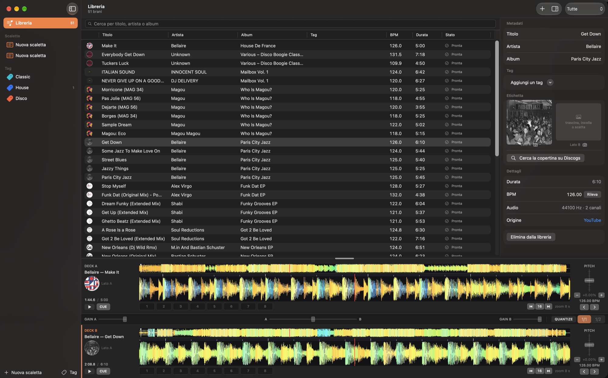

# Crate


Preparare un set cercando manualmente i dischi dalla propria collezione è sicuramente un lavoro
stupendo, ma se iniziano ad essere centinaia ricordarsi una specifica traccia diventa lungo e
tedioso. Ecco che nasce Crate, cercando unicamente le tracce su YouTube, basterà incollare il link
nell'app per scaricarle, analizzarle e cercare i metadati su Discogs. Questo permette in modo
estremamente rapido di catalogare la propria collezione e all'occorrenza di preparare un DJ set al
volo, ovunque voi siate, analizzando gli attacchi e provando rapidamente un cambio senza avere il
mixer a portata di mano!



---

## Cos'è

Crate tiene in un posto solo quello che altrimenti si sparpaglia fra il browser, una cartella di
file scaricati e un foglio di appunti.

**È un'app puramente locale**: nessun account, nessun server, nessuna sincronizzazione. I file
stanno sul tuo disco e basta.

---

## Funzionalità

### Libreria

- **Import da un link di YouTube.** Coda di download con progresso; un errore su un brano non
  blocca gli altri. Il parametro `&list=` viene ignorato: da un link dentro una playlist si importa
  il brano, non la playlist.
- **Metadati che si correggono a mano**: titolo, artista, album. L'euristica sul titolo di YouTube
  separa artista e titolo e ripulisce il rumore («Official Video», «HD», «Full Album»…), ma
  l'ultima parola è sempre tua.
- **Due foto dell'etichetta, lato A e lato B.** Si trascinano dal Finder, si incollano, o si
  scattano con la fotocamera — e con Continuity l'iPhone funziona come fotocamera, che è il modo
  pratico di fotografare un disco appoggiato sul tavolo.
- **Copertina e album da Discogs.** Cerchi l'edizione, la scegli dalla griglia delle copertine e ti
  porti dietro anche il titolo del disco.
- **Tag colorati** che ti definisci tu («disco», «funky», «classic»): si assegnano dal menu
  contestuale o trascinando i dischi sul tag nella barra laterale, e filtrano la libreria. Il
  filtro per tag è indipendente dalla ricerca testuale, così «senza etichetta» e «funky» sono due
  domande diverse che si possono fare entrambe.
- **Ricerca** per titolo, artista o album.

### Analisi

- **Waveform multi-risoluzione colorate a tre bande** (bassi, medi, alti), disegnate in Metal:
  è il colore che fa riconoscere a colpo d'occhio dove entra la cassa. Overview dell'intero brano
  più vista zoomata scorrevole.
- **BPM rilevato automaticamente** e **beatgrid a BPM costante**. Sulle tracce di prova le battute
  della griglia cadono entro 2–8 ms dagli attacchi di cassa per tutta la durata del brano.
- **Editor della griglia** quando il rilevamento sbaglia: ×2 e ÷2 per l'ottava, rifinitura del
  downbeat a 1 ms (10 ms tenendo ⇧), oppure ⌥ e trascini la griglia sulla waveform.

### I due deck

- **Motore audio a render callback custom**: il playhead è esatto al sample, quindi seek, scrub,
  CUE e hot cue cadono dove dici tu, anche in pausa.
- **Pitch varispeed ±8%**, come un SL‑1200: velocità e tonalità restano legate, perché è quello che
  succederà davvero sul piatto. Due pulsantini da 0,05% (0,5% con ⇧) per la rifinitura che il fader
  non può dare.
- **Nudge**: un colpetto da 10 ms per rimettere in fase, o tenuto premuto per una spinta del ±3%,
  come il bordo del piatto.
- **8 hot cue per traccia**, ognuno con un nome e una nota — «qui entra il basso», «attacca qui».
- **CUE stile rekordbox**, con l'anteprima tenendo premuto.
- **Salto di battute** da 8, 16, 32 o 64, per spostarsi dentro una frase o saltare alla parte dopo.
- **Quantize** sui cue, con aggancio a 1/1 o 1/2 di battuta.
- **Mixer**: gain per deck e crossfader a potenza costante.
- **Deck impilati** (predefinito, waveform a tutta larghezza) **o affiancati**.

### Scalette

- Trascini i brani dentro e li riordini col drag & drop.
- **Note come righe autonome**: puoi metterne più d'una fra due pezzi, o una in testa alla
  scaletta. Sono gli appunti di passaggio, non un campo attaccato alla traccia.
- Ogni riga mostra BPM e durata, e dice se il brano è caricato sul deck A o B.

---

## Cosa non fa, di proposito

Queste assenze non sono cose da fare un giorno: sono il motivo per cui l'app resta utile a chi
suona in vinile.

| Non c'è | Perché |
|---|---|
| Keylock / time‑stretch | Sul giradischi non esiste: se qui il pezzo tenesse la tonalità, l'idea di quanto si può tirare sarebbe sbagliata. |
| Loop | Non si fanno col vinile, e senza loop il resto dell'app resta semplice. |
| Pitch oltre ±8% | Un range più largo mentirebbe su quanto si potrà davvero spingere il disco. |
| Import di file locali o altre sorgenti | Il giro parte da YouTube. |
| Export (PDF, testo, copia dei file) | La scaletta serve davanti ai piatti, non da consegnare. |
| Preascolto in cuffia su un secondo device | Un solo device audio in uscita. |
| Genere, anno, rating, energy | Quattro campi e i tag bastano a ritrovare un disco in cassa. |

---

## Requisiti

- **macOS 26** o successivo, su **Apple Silicon**.
- **Xcode 26** o successivo, con il toolchain Metal (si scarica a parte, vedi sotto).
- **XcodeGen**: `brew install xcodegen`.
- Per le copertine, un **token personale di Discogs** (gratuito, dal tuo profilo Discogs).
  Senza, tutto il resto funziona.

---

## Compilare e installare

```bash
git clone git@github.com:gabrielvendrame/crate.git
cd crate

./Scripts/fetch-tools.sh                  # scarica yt-dlp e ffmpeg in Resources/Tools (~187 MB)
xcodebuild -downloadComponent MetalToolchain   # una tantum: senza, Waveform.metal non compila
xcodegen generate                         # genera Crate.xcodeproj da project.yml
./Scripts/install.sh                      # build Release e installa in /Applications
```

`yt-dlp` e `ffmpeg` non sono nel repository — li scarica `fetch-tools.sh` e finiscono dentro il
bundle dell'app, che così funziona su una macchina senza niente installato.

L'app è **firmata ad hoc**: compilata qui parte senza storie, ma una copia che arriva da AirDrop o
da un download porta l'attributo di quarantena, e Gatekeeper su una firma ad hoc non dice
«sviluppatore non verificato» — dice «l'app è danneggiata», che manda fuori strada. Non è
danneggiata:

```bash
xattr -dr com.apple.quarantine /Applications/Crate.app
```

Per portarla su un altro Mac, `./Scripts/install.sh --zip` prepara un archivio che conserva i
permessi di esecuzione dei sidecar (uno zip fatto in altro modo li perde).

---

## Guida d'uso

### 1. Portare dentro un disco

**⌘N** apre il pannello di import: incolli il link, premi *Aggiungi* e il brano entra in coda. Al
termine del download parte da sola l'analisi — waveform, BPM e griglia — e lo stato in tabella passa
a *Pronta*.

L'audio non viene mai ricodificato se si può evitare: YouTube serve AAC in `m4a`, che macOS apre
nativamente. Solo quando è disponibile il solo Opus/WebM si converte, e in ALAC lossless, per non
sommare una seconda perdita.

> yt-dlp invecchia in fretta: se un download comincia a fallire, **⌘,** → *Aggiorna yt-dlp*.

### 2. Sistemare i metadati

**⌥⌘I** apre l'ispettore. Correggi titolo, artista e album; trascina o incolla le foto
dell'etichetta nei due riquadri, oppure premi l'icona della fotocamera per scattarle (la prima
volta macOS chiede il permesso; con Continuity l'iPhone va sbloccato e vicino perché compaia fra le
fotocamere).

*Cerca la copertina su Discogs* mostra le edizioni trovate: scegli la tua e prendi copertina e
titolo dell'album in un gesto.

Per i tag: menu contestuale sulla riga, oppure trascini i dischi sul tag nella barra laterale.
Cliccando un tag nella barra laterale filtri la libreria.

### 3. Mettere i pezzi sui deck

Doppio clic carica sul deck A; **⌘1** e **⌘2** caricano il brano selezionato sul deck A o B.

**Spazio** suona e mette in pausa il deck che ha il fuoco, **D** passa all'altro. Trascinando la
waveform zoomata si scrubba; cliccando sull'overview si salta. **−** e **+** allargano e stringono
la vista zoomata.

Per mandare a tempo: il fader del pitch per il grosso, i pulsantini **−**/**+** per la rifinitura,
**Z** e **X** per il colpetto che rimette in fase (tenuti premuti, spingono del ±3%).

### 4. Cue point e punti di attacco

I pad **1–8** sono gli hot cue: un pad vuoto memorizza la posizione corrente, un pad pieno ci salta
e suona. **⇧1–⇧8** cancella. Ogni hot cue può avere un nome e una nota — è lì che scrivi «attacca
sul rullante» o «qui entrano gli archi».

Con il **quantize** acceso (**⌥⌘Q**) i cue si agganciano alla griglia, sia quando li memorizzi sia
quando ci salti: un punto piazzato a mano prima che ci fosse la griglia atterra comunque in battuta.

### 5. Griglia

Se il BPM è sbagliato di un'ottava, **G** apre l'editor: ×2 o ÷2 lo raddrizzano. Se la griglia è
giusta di tempo ma sfasata, rifinisci il downbeat o tieni **⌥** e trascina la griglia sulla
waveform.

### 6. Costruire la scaletta

**⇧⌘N** crea una scaletta. Ci trascini dentro i brani dalla libreria e li riordini trascinando.
Dalla barra strumenti aggiungi una **nota** dopo la riga selezionata: è una riga a sé, quindi fra
due pezzi puoi metterne quante ne servono.

### Scorciatoie

| Tasti | Cosa fa |
|---|---|
| **Spazio** | Riproduci o metti in pausa il deck attivo |
| **C** | CUE — tenuto premuto in pausa fa l'anteprima |
| **Z** · **X** | Nudge indietro e avanti · tenuti, spingono di ±3% |
| **D** | Passa il fuoco all'altro deck |
| **1 – 8** | Hot cue: pad vuoto memorizza, pad pieno salta e suona |
| **⇧1 – ⇧8** | Cancella l'hot cue di quello slot |
| **⌘1** · **⌘2** | Carica il brano selezionato sul deck A o B |
| **−** · **+** | Allarga o stringe la vista zoomata |
| **,** · **.** | Salta indietro e avanti della taglia scelta · tenuti, ripetono |
| **⌥⌘Q** | Accende e spegne il quantize |
| **G** | Apre l'editor della griglia del deck attivo |
| **⌥ e trascina** | Sposta la griglia sulla waveform zoomata |
| **⌥⌘R** | Rianalizza la traccia selezionata |
| **⌘N** | Aggiungi un brano da un link di YouTube |
| **⇧⌘N** | Nuova scaletta |
| **⌘F** | Cerca in libreria |
| **⌫** | Elimina la selezione, con conferma |
| **⌥⌘I** | Mostra o nasconde l'ispettore |
| **⌥⌘D** | Deck impilati o affiancati |
| **⌘,** | Impostazioni: token di Discogs e aggiornamento di yt-dlp |
| **⌘/** | Il pannello con tutte le scorciatoie |

---

## Dove stanno i dati

```
~/Library/Application Support/Crate/
  library.sqlite          il database: tracce, cue, scalette, tag
  Audio/<uuid>.m4a        i file scaricati
  Peaks/<uuid>.peaks      le waveform precalcolate
  Artwork/<uuid>-A.jpg    le foto dell'etichetta
  discogs-token           il token personale, in un file leggibile solo da te
```

Niente esce da qui. Per spostare la libreria su un altro Mac si copia questa cartella (a Crate
chiusa, per via del WAL di SQLite), saltando `Scratch/` e `Tools/`.

---

## Com'è fatta dentro

Swift 6 con concorrenza rigorosa, SwiftUI, nessun runtime interposto.

- **`DJKit`** è un package locale con tutta la logica testabile senza interfaccia: persistenza
  (GRDB 7 su SQLite), import, analisi DSP, client Discogs.
- **Il motore audio** usa `AVAudioSourceNode` con un render callback custom invece di
  `AVAudioPlayerNode`: con il player node la posizione riportata non coincide con ciò che si sente,
  che è esattamente la cosa che rompe un deck DJ.
- **Il render callback è real‑time**: nessuna allocazione, nessun lock, nessuna chiamata al
  runtime. La traccia intera sta in RAM come `Float` e il main thread comunica con il thread audio
  solo attraverso puntatori e variabili atomiche.
- **Le waveform** si disegnano in Metal da peaks precalcolati a quattro risoluzioni e tre bande di
  frequenza.

Le decisioni architetturali, con il perché di ciascuna e gli errori che hanno fatto scegliere così,
stanno in [`CLAUDE.md`](CLAUDE.md); il piano per esteso in [`PLAN.md`](PLAN.md) e lo stato dei
lavori in [`PROGRESS.md`](PROGRESS.md).

### Sviluppo

```bash
swift test --package-path DJKit        # test della logica, pochi secondi
./Scripts/check-render-callback.sh     # verifica che nel callback audio non entrino allocazioni
swift Scripts/make-app-icon.swift      # rigenera l'icona in tutte le misure
```

`Crate.xcodeproj` è **generato** da `project.yml`: non va modificato a mano, si rigenera con
`xcodegen generate` dopo ogni aggiunta di file o dipendenze.

---

## Licenza

[MIT](LICENSE).

L'app usa [yt-dlp](https://github.com/yt-dlp/yt-dlp) (Unlicense) e [FFmpeg](https://ffmpeg.org)
(LGPL/GPL), scaricati da `Scripts/fetch-tools.sh` e non inclusi nel repository, e
[GRDB](https://github.com/groue/GRDB.swift) (MIT).

Scaricare contenuti da YouTube può violare i termini di servizio della piattaforma e, a seconda del
materiale, i diritti di chi lo ha prodotto. Crate è uno strumento per il proprio lavoro di
preparazione: come lo usi, e con che materiale, è responsabilità tua.
